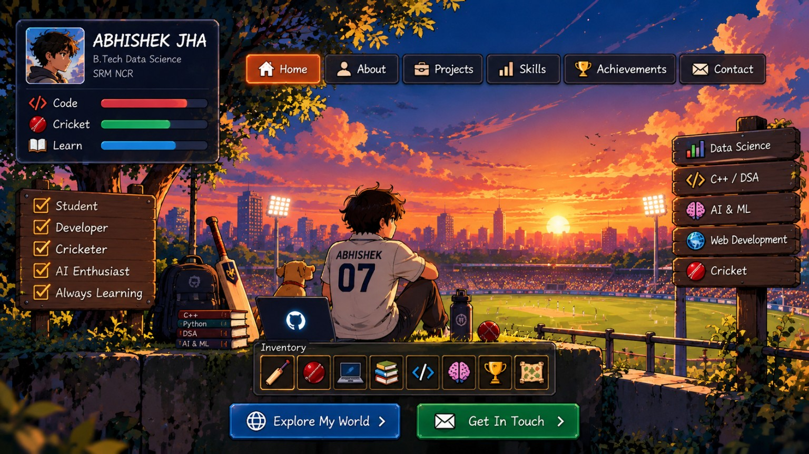

# 🏏 Abhishek Jha

### B.Tech Data Science Student | Cricket Lover | Developer

**Welcome to my world of code, cricket, and creativity!**

### ✨ Explore My Interactive Portfolio

---

## 👨‍💻 About Me

- 🎓 B.Tech Data Science student at SRM NCR
- 🏏 Cricket enthusiast
- 💻 Learning C++, Python, and Data Structures & Algorithms
- 🤖 Interested in AI, Machine Learning, and Data Science
- 🚀 Building projects and learning by doing

## 🛠️ Skills & Technologies

  
  
  
  
  
  

## 🚀 Featured Projects

### 🔥 Ageni — Industrial Fire Intelligence
An AI-focused project concept for industrial fire detection, risk intelligence, and incident analysis.

### 🆘 Aid Link
A prototype concept for connecting people with emergency assistance and nearby volunteers.

[**Explore Aid Link →**](https://aidlink404.netlify.app/)

## 🏆 Activities & Goals

- Participate in hackathons and project development.
- Improve my problem-solving and coding skills.
- Build useful projects with AI and data science.
- Keep learning and experimenting.

## 📊 GitHub Overview

## 📬 Connect With Me

- **GitHub:** [@abhishek45jha-lab](https://github.com/abhishek45jha-lab)
- **Portfolio:** [Explore My World](https://abhishek45jha-lab.github.io/)

---

### 🏏 Code with passion. Play with purpose. Keep learning.

*Thanks for visiting my profile!*

